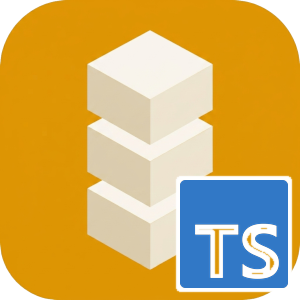

# Identisure JavaScript/TypeScript Client

[![npm][npm-image]][npm-url]
[![Downloads][downloads-image]][downloads-url]
[![Documentation][docs-image]][docs-url]
[![MIT license][license-image]][license-url]

[npm-image]: https://img.shields.io/npm/v/@identisure/client?style=flat-square 
[npm-url]: https://www.npmjs.com/package/@identisure/client
[downloads-image]: https://img.shields.io/npm/d18m/@identisure/client?style=flat-square
[downloads-url]: https://www.npmjs.com/package/@identisure/client?activeTab=versions
[docs-image]: https://img.shields.io/badge/github-docs-orange?logo=github&style=flat-square
[docs-url]: https://identisure.github.io/api-client-js
[license-image]: https://img.shields.io/badge/license-MIT-blue?style=flat-square
[license-url]: https://opensource.org/license/mit

API client for the [Identisure](https://developers.identisure.com) REST API. Ships ESM and CJS bundles with full type declarations.

Documentation: [identisure.github.io/api-client-js](https://identisure.github.io/api-client-js)

## Requirements

Node 20 or later.

## Supported providers

- **BankID SE**: auth, sign, phone auth and sign, QR verify, age verification
- **BankID NO**: auth, backchannel auth, sign, age verification
- **Freja eID**: auth, backchannel auth, sign, backchannel sign, age verification
- **MitID**: auth, backchannel auth, sign, age verification
- **FTN** (Finnish Trust Network): auth, age verification
- **Vipps MobilePay**: auth, backchannel auth
- **Documents**: upload and download documents for signing

## Installation

```sh
npm install @identisure/client
```

## Usage

```typescript
import { IdentisureClientBuilder } from "@identisure/client";

const client = new IdentisureClientBuilder("client_id", "client_secret")
  .environment("staging")
  .build();

const session = await client.bankidSe().auth({});

const result = await client.bankidSe().waitForAuth(session.id);

console.log(result);
```

### Verifying callbacks

Pass the raw request body exactly as received, before parsing it.

```ts
import { verifyCallbackSignature } from "@identisure/client";

const valid = await verifyCallbackSignature(rawBody, req.headers["x-signature-sha256"], hmacSecret);
```

## Development

#### Prerequisites

* [Node 22.12+ & npm 10+](https://nodejs.org/)

#### Clone

The test fixtures live in a git submodule:

```sh
$ git clone --recurse-submodules https://github.com/identisure/api-client-js.git
```

In an existing clone, run `git submodule update --init`.

#### Build

To build the project, simply issue the following command:

```sh
$ npm run build
```

#### Test

##### Linting

```sh
$ npm run check
$ npm run lint
```

##### Unit Testing 

```sh
$ npm run test
```

#### Release

Set the version in `package.json` and commit. Then push a tag:

```sh
$ git tag v0.1.0
$ git push origin v0.1.0
```

The release workflow checks that the tag matches the version, runs CI, publishes to npm and creates a GitHub release.

## Other languages

[C#](https://github.com/identisure/api-client-csharp), [Dart](https://github.com/identisure/api-client-dart), [Go](https://github.com/identisure/api-client-go), [Java/Kotlin](https://github.com/identisure/api-client-jvm), [PHP](https://github.com/identisure/api-client-php), [Python](https://github.com/identisure/api-client-py), [Ruby](https://github.com/identisure/api-client-ruby), [Rust](https://github.com/identisure/api-client-rust), [Swift](https://github.com/identisure/api-client-swift)
